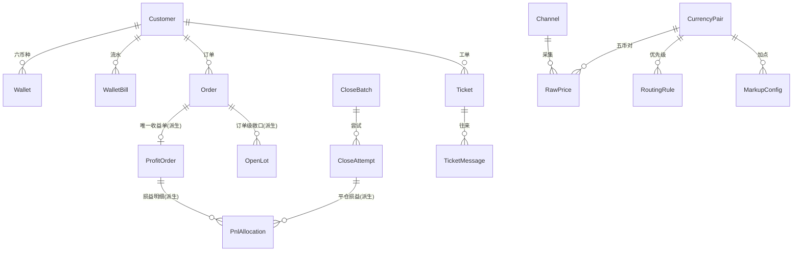
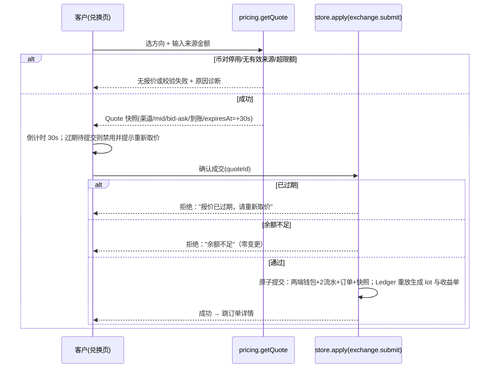
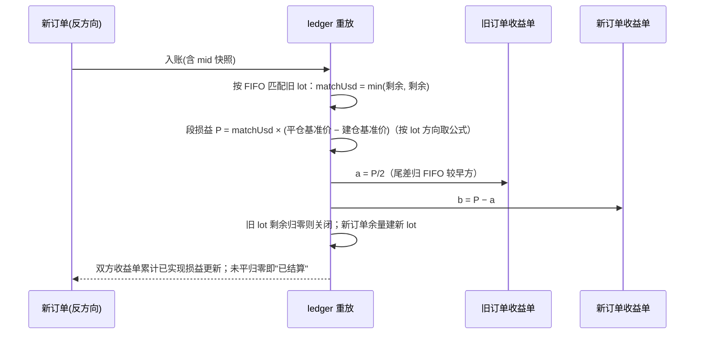
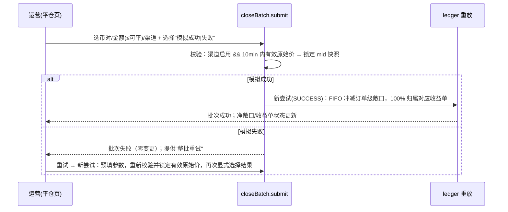
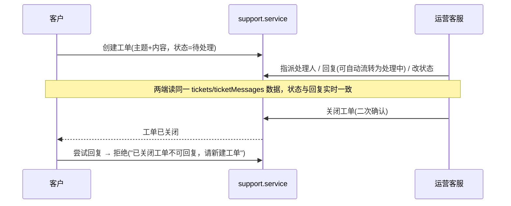

# 跨境汇兑平台前端原型 · 技术设计文档

- 版本：v1.0
- 日期：2026-10-28
- 对应需求：`docs/cross-border-fx-prototype-prd.md` v1.0（以下简称 PRD）
- 状态：定稿（7 项产品/技术决策已与负责人逐项确认，见 §2）

**文档关系**：PRD 定义产品行为口径 = 需求真理；本文档定义实现结构、算法与工程基线 = 实现真理。两者冲突时以 PRD 为准，并先回写本文档再改代码（Reverse Sync）。本文档是编码阶段的唯一实现依据（Spec is Truth）。

## 变更记录

| 版本 | 日期 | 说明 |
|---|---|---|
| v1.0 | 2026-10-28 | 初稿定稿：架构、领域引擎、数据与持久化、页面映射、测试与验收矩阵、里程碑 |

---

## 1. 目标、范围与交付物

### 1.1 目标

以纯前端 + 浏览器本地存储实现 PRD 全部功能：客户注册/充值/锁价兑换/订单/工单，运营总览/客户/交易（敞口、平仓、收益）/钱包/汇率运营/客服，含渠道原始价采集、路由选源、净敞口、FIFO 自然对冲与渠道平仓、收益订单结算的模拟闭环。

### 1.2 交付物

1. 可构建的静态站点（`npm run build` 产物可直接丢任意静态托管/本地打开预览）。
2. Vitest 单元测试：覆盖领域计算引擎、存储层与预置数据一致性（见 §12）。
3. 预置演示数据 + 重置入口，两端（`/app/*`、`/ops/*`）完整可用。
4. API 契约层（`src/api/*`，§8）：与领域服务 1:1 对齐的类型化 POST 接口函数 + HTTP 客户端；本期不发起真实网络请求，供后端（Spring Boot/JSON）对接期直接启用。

### 1.3 非目标（技术侧）

SSR/SSG、PWA/Service Worker、多标签页实时同步、i18n 框架、暗色模式、后端联调与真实网络请求（本期交付 API 契约层但不接入，无 Mock Server/MSW）、E2E 框架、CI 流水线（本地质量门禁命令为准，CI 后续可接）。产品侧非目标见 PRD §1.2。

### 1.4 运行与浏览器支持

- Node 26 线（`.nvmrc` 写 `26`；`engines.node: ">=26 <27"`）。Vitest 5 同时支持 `^24`，若团队基座为 Node 24 亦可行，仅需整体对齐 `.nvmrc` 与本地环境。
- 桌面浏览器：Chrome/Edge/Safari/Firefox 最近两个大版本。不支持 IE。
- 主设计稿宽度 1280px 起；较窄视口下运营宽表容器内横向滚动（PRD §8）。

---

## 2. 已确认决策摘要

以下 7 项已与负责人逐项确认；D11 为后端对接预留的补充需求；另 3 项（D8–D10）为版本核实后引入的实现决策。

| # | 决策点 | 结论 | 影响章节 |
|---|---|---|---|
| D1 | 技术栈基线 | Vite + React 19 + TypeScript + Tailwind v4 + shadcn/ui + React Router v8（库模式/declarative），图表用 shadcn Charts（Recharts） | §3、§4 |
| D2 | 数据层 | Zustand 单 store 按领域切片 + persist 写 localStorage；写操作经领域服务纯函数生成完整新状态后**一次原子提交** | §5、§7 |
| D3 | 精度方案 | decimal.js 全链路 Decimal；汇率内部 12 位有效位；入账/展示按币种精度 ROUND_HALF_UP；分摊与尾差在内部精度完成 | §6.1 |
| D4 | 测试策略 | Vitest 覆盖领域计算引擎 + 存储迁移/损坏恢复 + seed 一致性；UI 走手工验收清单（§12） | §12 |
| D5 | 模拟采集 | 确定性步长序列循环：每币对预置百分比步长序列，点击按序应用并刷新采集时间，`nextIndex` 持久化 | §5.5、§6.2 |
| D6 | 首页 USD 估值 | 用采集池该币对**最近一次采集的原始中间价**（忽略 10 分钟新鲜度与渠道启停），标注“参考估值”；无任何价格时该币不计入并轻提示 | §10.2 |
| D7 | 损益精度 | 损益内部 Decimal 高精度记账、不逐段舍入；展示按报价币精度舍入（JPY 0 位、其余 2 位） | §6.1、§6.6 |
| D8 | TypeScript 版本 | 锁 **6.0.3**（typescript-eslint 8.72.1 peer 上限 `<6.1.0`，TS 7.0.2 不兼容）。typescript-eslint 支持 TS 7 后再升级 | §3 |
| D9 | 路由库版本 | **react-router 8.5.1**（v8 已移除 `react-router-dom` 包，统一从 `react-router` 导入；declarative API 与 v6 写法一致；peer `react >= 19.2.7` 满足） | §3、§4.1 |
| D10 | 顶点包 react-is | recharts 3 的 peer 仍为旧式 react-is 范围，按 shadcn 文档在 `package.json` 增加 `overrides: { "react-is": "$react" }` 收敛到与 react 同版本 | §3.2 |
| D11 | API 契约层（后端对接预留） | 按功能模块一文件（`src/api/*` + `index.ts` 聚合），全部 POST + JSON、统一包裹 `{code,message,data}`；与领域服务 1:1 对齐，本期仅预留不接入 UI，对接期机械替换 | §8 |

**设计决策记录（ADR）**：本文档 §5.3（事实/派生分离与账本重放）、§6.1（全链路 Decimal）、§7（Zustand + 服务纯函数原子提交）、§5.5（确定性采集）具备 ADR 形态，评审通过后建议同步至 `docs/decisions.md`（ADR-001..004）。

---

## 3. 技术栈与版本锁定

版本来源：npm registry `latest` dist-tag，核实时间 2026-10-28，全部为稳定版（无 beta/rc/canary）。**安装时逐项锁定精确版本，禁用 `latest`/`*`/`^x.y`**（R5）。

### 3.1 运行时依赖（dependencies）

| 包 | 精确版本 | 用途 |
|---|---|---|
| react | 19.3.1 | UI 框架 |
| react-dom | 19.3.1 | DOM 渲染 |
| react-router | 8.5.1 | 路由（declarative 库模式；v8 起无 react-router-dom 包） |
| zustand | 5.0.16 | 状态管理（持久化为手写变更订阅，见 §5.3） |
| immer | 11.2.9 | 不可变更新（zustand middleware） |
| decimal.js | 10.6.0 | 金额/汇率精度计算 |
| recharts | 3.10.1 | 图表（shadcn Chart 基于 Recharts v3） |
| react-hook-form | 7.91.0 | 表单状态与校验 |
| @hookform/resolvers | 6.0.1 | zod 校验适配（经 standard-schema） |
| zod | 4.6.7 | 表单 schema 校验 |
| dayjs | 1.11.23 | 日期格式化与区间筛选 |
| lucide-react | 1.62.0 | 图标 |
| class-variance-authority | 0.7.1 | shadcn 组件变体 |
| clsx | 2.1.1 | className 合并 |
| tailwind-merge | 3.7.0 | Tailwind 冲突消解 |
| sonner | 2.0.8 | Toast 提示（shadcn 推荐） |
| radix-ui | 1.8.1 | Radix 统一包（CLI 4.x 新式组件自 `radix-ui` 导入，替代分散的 `@radix-ui/react-*`） |

shadcn CLI 生成组件引用的 Radix 原语经统一包 `radix-ui@1.8.1` 提供，由 `package-lock.json` 锁定；升级走整体 `shadcn add` 流程。生成文件中的 `cn` 导入已统一改为项目内 `@/lib/utils`（不引入 `cn` 包）。

### 3.2 开发依赖（devDependencies）

| 包 | 精确版本 | 用途 |
|---|---|---|
| typescript | 6.0.3 | 类型系统（D8：避开 TS7 与 typescript-eslint 的 peer 冲突） |
| vite | 8.3.5 | 构建 |
| @vitejs/plugin-react | 6.1.2 | React 插件（peer 仅支持 vite 8，与 8.3.5 匹配；不可单独降级 vite） |
| tailwindcss | 4.3.3 | 样式引擎 |
| @tailwindcss/vite | 4.3.3 | Tailwind v4 的 Vite 插件（与 tailwindcss 同版本） |
| tw-animate-css | 1.4.0 | 动画工具类（tailwindcss-animate 已停更，shadcn 官方替代） |
| shadcn | 4.23.0 | 组件 CLI（`npx shadcn@4.23.0 init` / `add`） |
| vitest | 5.0.5 | 单测（peer `vite ^6.4.0 \|\| ^7 \|\| ^8` 满足） |
| eslint | 10.13.0 | Lint 基线 |
| @eslint/js | 10.0.1 | ESLint 推荐规则 |
| typescript-eslint | 8.72.1 | TS 规则（peer `eslint ^8.57 \|\| ^9 \|\| ^10`、`typescript <6.1.0`） |
| eslint-plugin-react-hooks | 7.1.1 | Hooks 规则 |
| eslint-plugin-react-refresh | 0.5.7 | HMR 规则 |
| prettier | 3.9.10 | 格式化（格式化全部交给 Prettier，ESLint 不启用风格类规则，故无需 eslint-config-prettier） |
| globals | 17.13.0 | ESLint 全局变量定义 |
| jsdom | 30.1.3 | 渲染冒烟用例的 DOM 环境（仅 `routes.test.tsx` 单文件启用，见 §12.1） |
| @types/react | 19.3.0 | 类型 |
| @types/react-dom | 19.3.0 | 类型 |
| @types/node | 26.6.5 | Node 端类型（与 Node 26 线对齐，仅用于 vite.config 等） |

### 3.3 package.json 关键字段（实现起点）

```jsonc
{
  "name": "fx-front",
  "private": true,
  "type": "module",
  "engines": { "node": ">=26 <27" },
  "scripts": {
    "dev": "vite",
    "build": "tsc --noEmit && vite build",
    "preview": "vite preview",
    "test": "vitest run",
    "test:watch": "vitest",
    "typecheck": "tsc --noEmit",
    "lint": "eslint .",
    "format": "prettier --write ."
  },
  "overrides": {
    // D10：recharts 3 仍声明旧式 react-is peer 范围，React 19 下收敛到与 react 同版本
    "react-is": "$react"
  }
}
```

依赖版本安装后固化进 `package-lock.json`；提交锁文件，禁止手工改版本。若 `shadcn add` 个别旧组件触发 npm ERESOLVE，仅对该次安装使用 `--legacy-peer-deps`，并记录到 PR 说明。

### 3.4 工程配置要点

- `tsconfig.json`：`strict: true`、`noUncheckedIndexedAccess: true`、`verbatimModuleSyntax: true`，路径别名 `@/* → src/*`（`vite.config.ts` 同步 alias；不使用已废弃的 `baseUrl`，TS6 起该项报 TS5101）。
- `vite.config.ts`：`@vitejs/plugin-react` + `@tailwindcss/vite` 双插件；`test` 配置内联（`environment: 'node'`，纯函数单测不依赖 DOM，localStorage 用测试桩注入，见 §12.1）。
- `eslint.config.js`：flat config = `js.configs.recommended` + `tseslint.configs.recommended`（不做 type-aware lint，类型正确性由 `tsc --noEmit` 门禁保证，换取速度与稳定性）+ `react-hooks` + `react-refresh`。
- 质量门禁：`npm run lint && npm run typecheck && npm run test && npm run build` 全绿方可提交。

---

## 4. 工程结构与运行时架构

### 4.1 目录结构（实现级，文件名为准）

```
fx-front/
├─ docs/                          # prd / 本文档 / code-standards / decisions
├─ public/
├─ src/
│  ├─ main.tsx                    # 入口：await 恢复存储/初始化 seed 后再挂载 App
│  ├─ App.tsx                     # BrowserRouter（声明式路由）+ Providers（banner + Toaster）+ 路由表
│  ├─ app/
│  │  ├─ routes.tsx               # 路由表（§10.1）
│  │  ├─ guards.tsx               # RequireClient / RequireOps / RedirectIfAuthed
│  │  └─ providers.tsx            # 主题 class、Toaster 等 Provider 装配
│  ├─ layouts/
│  │  ├─ ClientLayout.tsx         # 客户端壳：顶栏导航 + 演示资金标识
│  │  ├─ ClientAuthLayout.tsx     # 客户端登录/注册壳
│  │  ├─ OpsLayout.tsx            # 运营壳：侧边栏 6 项 + 顶栏（含重置入口）
│  │  └─ OpsAuthLayout.tsx        # 运营登录壳
│  ├─ pages/
│  │  ├─ client/                  # 见 §10.1 路由表（11 个页面文件）
│  │  ├─ ops/                     # 见 §10.1 路由表（19 个页面文件）
│  │  └─ NotFoundPage.tsx         # 404（极简 + 返回入口）
│  ├─ features/                   # 业务交互组件 + 局部 hooks（按领域目录）
│  │  ├─ auth/ wallet/ exchange/ orders/ support/
│  │  ├─ exposure/ close-batches/ profit-orders/
│  │  ├─ fx-config/               # channels/pairs/pool/routing/markups/calculator 子目录
│  │  └─ customers/ analytics/    # 运营客户管理 / 总览趋势图
│  ├─ domain/                     # 纯 TS，零 React/零 zustand 依赖（核心资产）
│  │  ├─ types.ts                 # 全部领域类型（附录 A）
│  │  ├─ constants.ts             # 全局常量（附录 C）
│  │  ├─ money.ts                 # Decimal 封装、币种精度、舍入、格式化
│  │  ├─ pricing.ts               # 报价引擎：选源、bid/ask、限额、快照
│  │  ├─ fifo.ts                  # 敞口台账：自然对冲、渠道平仓分配
│  │  ├─ pnl.ts                   # 损益计算、50/50 分摊、尾差
│  │  ├─ ledger.ts                # 重放引擎 buildLedger（§6.7）
│  │  ├─ ids.ts                   # 编号生成（§附录 D）
│  │  ├─ seed.ts                  # 预置数据构建（§5.5）
│  │  └─ services/                # 领域写操作：cmd → Result<新状态>
│  │     ├─ auth.service.ts
│  │     ├─ wallet.service.ts
│  │     ├─ exchange.service.ts
│  │     ├─ close-batch.service.ts
│  │     ├─ fx-config.service.ts
│  │     ├─ support.service.ts
│  │     └─ customer.service.ts
│  ├─ store/
│  │  ├─ index.ts                 # createStore + persist + 服务调用入口 apply()
│  │  ├─ persistence.ts           # localStorage 安全读写、版本迁移、损坏恢复
│  │  ├─ selectors.ts             # 派生选择器（memoized，§7.3）
│  │  └─ slices/
│  │     ├─ session.slice.ts      # 客户/运营会话（持久化）
│  │     ├─ data.slice.ts         # 全部业务事实（持久化）
│  │     └─ ui.slice.ts           # 弹窗/倒计时/banner 等临时态（不持久化）
│  ├─ api/                        # API 契约层（后端对接预留，§8；本期不接入 UI）
│  │  ├─ http.ts                  # fetch 封装：POST/JSON、包裹解包、15s 超时、错误归一、token 注入（预留）
│  │  ├─ errors.ts                # 业务错误码 → 文案与处理策略
│  │  ├─ dto.ts                   # 请求/响应 DTO（金额一律 DecimalStr）
│  │  ├─ index.ts                 # 聚合导出（authApi/walletApi/…）
│  │  ├─ auth.ts                  # 认证
│  │  ├─ wallet.ts                # 客户钱包（余额/流水/充值）
│  │  ├─ exchange.ts              # 兑换（取价/成交）
│  │  ├─ orders.ts                # 客户订单
│  │  ├─ support.ts               # 工单（客户+运营共用）
│  │  ├─ fx-config.ts             # 汇率运营
│  │  ├─ trading.ts               # 运营交易（订单/敞口/平仓/收益）
│  │  ├─ ops-wallet.ts            # 运营钱包（余额/账单/代客充值）
│  │  ├─ ops-customer.ts          # 运营客户管理
│  │  └─ overview.ts              # 运营总览
│  ├─ lib/
│  │  ├─ storage.ts               # StorageAdapter 抽象（localStorage/内存降级/测试桩）
│  │  ├─ clock.ts                 # now() 可注入时钟（测试固定时间用）
│  │  ├─ format.ts                # 日期/百分比/编号展示格式化
│  │  ├─ hash.ts                  # 演示级口令哈希 SHA-256(salt:password)（Web Crypto）
│  │  ├─ uuid.ts                  # crypto.randomUUID 包装
│  │  └─ utils.ts                 # cn()（clsx + tailwind-merge），全站唯一 className 合并出口
│  ├─ mocks/
│  │  └─ seed-script.ts           # 预置交易/充值/工单事件脚本（§5.5 数据表）
│  ├─ components/
│  │  ├─ common/                  # Money、StatusBadge、DataTable、EmptyState、ConfirmDialog、PageHeader、PlaceholderPage、StorageRecoveryBanner（Countdown 随 M3）
│  │  └─ ui/                      # shadcn CLI 生成，勿手改（改走 CLI/包装层）
├─ tests/                         # 仅放跨模块金样测试；域内单测就近 *.test.ts
├─ .nvmrc                         # 26
└─ 其余工程配置（tsconfig / vite.config / eslint.config / .prettierrc）
```

**依赖方向铁律**：`pages → features → store → domain → lib`；`domain` 禁止 import React/zustand（可被纯函数单测直接覆盖）；`features` 禁止直接 setStore，只能通过 `store/index.ts` 暴露的服务入口（经 feature 薄 hooks，见 §7.2、§8.6）；`api/` 独立于 store、仅依赖 `lib`，本期不被 UI 调用。违反即回退重写。

### 4.2 命名约定

- 组件文件 `PascalCase.tsx`；领域/工具模块 `camelCase.ts`；测试 `*.test.ts` 就近放置。
- 领域枚举用英文大写常量（`SELL_USD`/`LONG`），展示文案统一由 `features/*/labels.ts` 映射为中文。
- 持久化数据中 Decimal 一律存**普通十进制字符串**（`Decimal.set({ toExpNeg: -40, toExpPos: 40 })` 保证不出现科学计数法），禁止存 number。

### 4.3 路由与守卫（运行时）

- 客户端壳 `ClientLayout`：顶栏导航（首页/钱包/兑换/订单/客服）+ 用户菜单（含退出），全页带「演示资金」氛围标识。
- 运营壳 `OpsLayout`：左侧栏六项一级导航（总览/客户管理/交易管理/钱包管理/汇率运营/客服处理），二级为页内 Tabs/子菜单；顶栏显示运营账号 + 「重置演示数据」入口（AlertDialog 二次确认）。
- 守卫（`app/guards.tsx`）：
  - `RequireClient`：无客户会话 → `/app/login`；**运营会话不通行**（双端身份隔离，PRD §2）。
  - `RequireOps`：无运营会话 → `/ops/login`；客户账号一律不可进入运营端。
  - `RedirectIfAuthed`：已登录访问登录/注册页 → 对应首页。
  - `/` → 有客户会话去 `/app/home`，否则 `/app/login`；未知路径 → 404 页（极简，含返回入口）。
- 会话持久化：刷新后保持登录（存 `session` 切片；退出登录清除）。演示认证说明：密码经 `SHA-256(salt + password)`（Web Crypto）存哈希，明确注释为**演示级方案，非生产认证**。

### 4.4 时钟与倒计时

- 全部“当前时间”取自 `lib/clock.ts` 的 `now()`（默认 `Date.now`，测试/seed 可注入固定时钟），保证 30 秒锁价与 10 分钟新鲜度的边界可测。
- 兑换页倒计时：以 `expiresAt - now()` 每秒渲染；`now() >= expiresAt` 即视为过期（提交按钮禁用 + 提示“报价已过期，请重新取价”）。报价为内存态（ui 切片），刷新页面即失效需重新取价——符合演示语义，且避免持久化临时态。

---

## 5. 领域模型与数据架构

### 5.1 设计基调：事实 / 派生分离 + 账本重放（ADR-001）

持久化只存**业务事实**（用户动作与配置的历史），敞口台账、收益订单、损益分摊等**账本一律由确定性重放引擎从事实推导**：

- 事实（持久化）：客户/凭证、钱包余额、钱包流水、客户订单（含全部价格快照）、平仓批次与尝试（含锁定价格快照）、工单与消息、汇率运营配置（渠道/币对/采集池/路由/加点/采集步长序号）、计数器、会话、meta。
- 派生（不持久化，`buildLedger(facts)` 计算 + memoized）：订单级未平敞口 OpenLot、收益订单 ProfitOrder、损益分配明细 PnlAllocation、五币对净敞口与可平金额、总览指标。
- 收益订单号 1:1 由客户订单号派生（`EX-… → PO-…` 前缀替换），分配明细序号按确定性重放顺序生成——**重放幂等**，任意时刻重建结果一致。
- 好处：跨实体一致性由构造保证（PRD §7 “关联页面使用同一模拟数据源”），杜绝“订单改了、敞口没改”类漂移；单测可直接对纯函数重放做金样断言。
- 代价：每次状态变更后 O(订单数+批次尝试数) 重放，原型数据量（<1 千条）下毫秒级，可接受。

重放确定性条件（实现必须满足）：
1. 事实按 `createdAt` 升序处理，同时间戳按 id 字典序；id 生成单调递增（§附录 D）。
2. 订单/尝试必须携带成交/锁定时点的原始中间价与渠道快照（PRD §6.1 明确要求）；重放不得读取“当前价”。
3. Decimal 舍入规则全局固定（§6.1），重放路径与在线路径共用同一批纯函数。

### 5.2 实体关系（ER 概览）



完整字段定义见附录 A。

### 5.3 localStorage 布局与生命周期

- **单键存储**：`fxprot:state:v1`，值为 `{ version: number, savedAt: number, data: { session, data } }`。单键保证原子提交与整体恢复，规避多键半写状态。
- 写入：手写变更订阅落盘（`store/index.ts` 在 bootstrap 时 `subscribe`，仅当 `session`/`data` 引用变化才写——等价 persist `partialize` 语义，排除全部 UI 临时态）。WHY 不用 zustand persist 中间件：损坏恢复需要异步重放 seed，中间件同步水合路径不适用（实现注记 2026-10-28）。
- 读取（`store/persistence.ts`）：
  1. `JSON.parse` 失败 / 结构校验失败 / `version` 高于当前 → 丢弃并重建 seed，置 `uiSlice.storageRecovered = true`（两端顶部轻量 banner：“本地演示数据不可用，已恢复为预置样例”，可关闭），**不得白屏**（PRD §9-11）。
  2. `version` 低于当前 → 依次执行迁移函数表 `migrations: Record<number, (data) => data>`；当前 v1 无迁移，机制先行。
  3. 存储不可用（无痕模式/配额异常）：`lib/storage.ts` 检测失败后降级为内存 Map 实现，功能可用但刷新丢失，顶部常驻提示。
- 容量：原型量级（<2MB）远低于 localStorage 上限；无特殊处理。
- 多标签页：**不支持同步**，后写覆盖（last-write-wins）。文档显式声明为已知限制（§14）。
- 「重置演示数据」：以当前时刻为锚重新 `seed.build(now)` 整体替换（变更订阅随即落盘）→ `meta.resetCount++`（在旧值上递增）。语义为工厂重置：已注册客户与全部运行期数据一并清除（与“恢复初始预置样例”一致）。

### 5.4 预置数据（seed）

构建原则：seed 不是一堆手写常量，而是**脚本化事实 + 引擎推导**。`mocks/seed-script.ts` 定义客户、配置与有序事件脚本；`domain/seed.ts` 以锚点时间（首次打开/重置的当前时刻）回推生成事实（余额由期初 + 增量累计得出），账本部分交给重放引擎。以下数值即金样断言（§12.1 seed 测试逐条断言）。

**锚点**：`T0 = 首次打开时刻`；预置报价 `collectedAt = T0 - 2min`（新鲜）；各类时间按相对偏移生成。

**账号**

| 角色 | 账号 | 密码（登录页可见提示） | 说明 |
|---|---|---|---|
| 客户 C-001 林小满 | `linxiaoman@demo.fx` | `Demo1234` | 主演示客户 |
| 客户 C-002 陈屿 | `chenyu@demo.fx` | `Demo1234` | |
| 客户 C-003 苏晚 | `suwan@demo.fx` | `Demo1234` | |
| 运营 OPS-001 演示管理员 | `ops@demo.fx` | `OpsDemo123` | 运营端登录；登录页提供演示凭证提示 |
| 处理人名单 | 王倩 OPS-002 / 李昂 OPS-003 / 赵敏 OPS-004 | — | 工单分派用（PRD §5.6） |

**渠道与采集池**（原始中间价，单位：1 USD = R 报价币）

| 渠道 | 状态 | USD/EUR | USD/GBP | USD/JPY | USD/CNH | USD/HKD |
|---|---|---|---|---|---|---|
| CH-01 华星清算 | 启用 | 0.9200 | 0.7850 | 151.20 | 7.2450 | 7.8100 |
| CH-02 北岭报价 | 启用 | 0.9205 | 0.7852 | 151.00 | 7.2460 | 7.8110 |
| CH-03 青屿流动池 | **停用** | 0.9198 | 0.7848 | 150.90 | 7.2430 | 7.8080 |

**路由优先级**：USD/EUR、USD/GBP、USD/CNH、USD/HKD 为 `[CH-01, CH-02, CH-03]`；USD/JPY 为 `[CH-02, CH-01, CH-03]`（演示“主渠道非第一位”的回退语义）。
**加点**：五币对均 50 bps/侧；**币对**：五对全部启用。
**采集步长序列**（D5，单位 %，循环使用）：`["-0.12", "+0.20", "-0.08", "+0.15"]`，五币对同构不同初始相位；`nextIndex` 持久化于配置。

**交易事件脚本**（9 笔成功订单，均已完成；“到账”为引擎按 §6.2 公式计算值，此处列出即断言值）

| # | 时间 | 客户 | 币对 | 方向 | 来源金额 | 基准 mid（渠道） | 客户成交价 | 到账 |
|---|---|---|---|---|---|---|---|---|
| EX-1 | T0-5d | C-001 | USD/EUR | 卖 USD 买 EUR | 2,000.00 USD | 0.9200 (CH-01) | 0.9154 | 1,830.80 EUR |
| EX-2 | T0-4d | C-002 | USD/EUR | 卖 EUR 买 USD | 740.08 EUR | 0.9205 (CH-02) | 0.9251 | 800.00 USD |
| EX-3 | T0-3d | C-001 | USD/EUR | 卖 USD 买 EUR | 1,500.00 USD | 0.9195 (CH-01) | 0.9149 | 1,372.35 EUR |
| EX-4 | T0-4d | C-003 | USD/JPY | 卖 USD 买 JPY | 5,000.00 USD | 151.20 (CH-01) | 150.4440 | 752,220 JPY |
| EX-5 | T0-2d | C-002 | USD/JPY | 卖 JPY 买 USD | 300,000 JPY | 151.00 (CH-02) | 151.7550 | 1,976.87 USD |
| EX-6 | T0-3d | C-001 | USD/GBP | 卖 USD 买 GBP | 6,000.00 USD | 0.7850 (CH-01) | 0.7811 | 4,686.45 GBP |
| EX-7 | T0-2d | C-003 | USD/CNH | 卖 CNH 买 USD | 8,737.47 CNH | 7.2450 (CH-01) | 7.2812 | 1,200.00 USD |
| EX-8 | T0-1d | C-002 | USD/HKD | 卖 HKD 买 USD | 7,850.06 HKD | 7.8110 (CH-02) | 7.8501 | 1,000.00 USD |
| EX-9 | T0-12h | C-003 | USD/HKD | 卖 USD 买 HKD | 400.00 USD | 7.8100 (CH-01) | 7.7710 | 3,108.38 HKD |

**平仓批次脚本**

| 批次 | 时间 | 币对 | 金额 | 渠道 | 锁定 mid | 模拟结果 |
|---|---|---|---|---|---|---|
| CB-1 | T0-2d | USD/EUR | 1,000.00 USD | CH-01 | 0.9202 | 成功（FIFO 命中 EX-1） |
| CB-2 | T0-1d | USD/JPY | 1,500.00 USD | CH-02 | 151.00 | 失败（演示整批重试） |

**充值脚本**：C-003 自助充值 CNH +5,000（T0-2d）；C-002 代客充值 USD +2,000（T0-1d，运营 OPS-001，备注“演示：客诉补偿入账”）。

**客户期初余额**（预置样例客户为“老客户”，期初大于新注册赠送；仅新注册客户按 PRD §3.1 获赠 USD 1,000 / GBP 800 / EUR 900 / JPY 150,000 / CNH 7,200 / HKD 7,800）：

- C-001：USD 30,000 / EUR 5,000 / GBP 3,000 / JPY 500,000 / CNH 20,000 / HKD 30,000
- C-002：USD 15,000 / EUR 8,000 / GBP 2,000 / JPY 900,000 / CNH 50,000 / HKD 10,000
- C-003：USD 12,000 / EUR 2,000 / GBP 1,000 / JPY 2,000,000 / CNH 30,000 / HKD 5,000

**金样断言（seed 测试逐条验证）**

净敞口（§6.4 重放结果）：

| 币对 | 净敞口 | 构成 |
|---|---|---|
| USD/EUR | +1,700.00 USD（多头） | EX-1 剩余 200 + EX-3 全部 1,500 |
| USD/GBP | +6,000.00 USD（多头） | EX-6 |
| USD/JPY | +3,023.13 USD（多头） | EX-4 剩余（5,000 − 1,976.87） |
| USD/CNH | −1,200.00 USD（空头） | EX-7 |
| USD/HKD | −600.00 USD（空头） | EX-8 剩余（1,000 − 400） |

收益订单（9 张，1:1）：

| 收益单 | 状态 | 已实现损益（报价币） | 未平 USD |
|---|---|---|---|
| PO-EX-1 | 部分实现 | +0.40 EUR（自然对冲 800×0.0005=+0.40 中归属 +0.20；渠道平仓 1,000×0.0002=+0.20） | 200.00 |
| PO-EX-2 | 已结算 | +0.20 EUR（自然对冲归属一半，尾差 0） | 0 |
| PO-EX-3 | 待实现 | 0 | 1,500.00 |
| PO-EX-4 | 部分实现 | −197.687 JPY（1,976.87×(151.00−151.20)=−395.374，各半） | 3,023.13 |
| PO-EX-5 | 已结算 | −197.687 JPY | 0 |
| PO-EX-6 | 待实现 | 0 | 6,000.00 |
| PO-EX-7 | 待实现 | 0 | 1,200.00 |
| PO-EX-8 | 部分实现 | +0.20 HKD（400×(7.8110−7.8100)=+0.40，各半） | 600.00 |
| PO-EX-9 | 已结算 | +0.20 HKD | 0 |

余额金样（期初 + 脚本增量累计值）：C-001 `USD 20,500.00 / EUR 8,203.15 / GBP 7,686.45 / JPY 500,000 / CNH 20,000 / HKD 30,000`；C-002 `USD 20,776.87 / EUR 7,259.92 / GBP 2,000 / JPY 600,000 / CNH 50,000 / HKD 2,149.94`（EX-2/EX-5/EX-8 均为买 USD，USD 腿为入账）；C-003 `USD 7,800.00 / EUR 2,000 / GBP 1,000 / JPY 2,752,220 / CNH 26,262.53 / HKD 8,108.38`。

**工单脚本**：TK-001 待处理（C-001「EUR 到账金额与预期不一致」，1 条客户消息）；TK-002 处理中（C-002「报价过期提示咨询」，处理人王倩，客户 + 运营各 1 条）；TK-003 已关闭（C-003「如何查看钱包账单」，客户 + 运营各 1 条后关闭）。

---

## 6. 领域计算引擎（核心算法规范）

全部为 `domain/` 纯函数，禁止依赖 React/store；所有金额与汇率运算**必须且只能**经 `money.ts`（禁止直接对 number 做 `* / + -`，评审必查）。

### 6.1 精度、单位与舍入（ADR-002）

- 全局配置：`Decimal.set({ precision: 20, rounding: Decimal.ROUND_HALF_UP, toExpNeg: -40, toExpPos: 40 })`。
- 汇率表示：统一 `1 USD = R 报价币`。渠道原始价入池时归一化：供应商按 USD/JPY（USD per JPY，如 0.006614）报送时取倒数；按 JPY/USD（JPY per USD，如 151.20）报送直接使用（PRD §6.1“方向相反先归一化”）。内部存储 12 位有效位（`toSignificantDigits(12)`）。
- 币种精度表：`USD 2 | GBP 2 | EUR 2 | JPY 0 | CNH 2 | HKD 2`（PRD §4.3）。
- 舍入函数：`roundCcy(v: Decimal, ccy): Decimal`（按上表 `toDecimalPlaces(dp, ROUND_HALF_UP)`）；目标金额“按最近最小单位四舍五入”即此规则。
- **内部高精度、出口才舍入（D7）**：敞口、损益、50/50 分摊等台账计算全程保留 Decimal 精度、不逐段舍入；仅“钱包入账/出账金额、客户订单到账金额、展示层”按币种精度舍入。审计明细同时展示高精度原值；展示层各自舍入可能造成“两笔分摊显示值之和 ≠ 显示总额 ±1 最小单位”，属预期，以内部值为准（在明细说明中注明）。
- 展示格式：金额 = 千分位 + 币种精度 + 币种代码后缀（如 `150,000 JPY`、`7,200.00 CNH`）；汇率 = 固定 4 位小数（如 `0.9251`、`151.2000`）；百分比 = 整数 bps。

### 6.2 报价引擎（`domain/pricing.ts`）

```
getQuote(fxConfig, req: { pairId, direction, sourceAmount }, now): QuoteResult
QuoteResult = { ok: true, quote: Quote } | { ok: false, reason: NoQuoteReason, diagnostics: ChannelDiag[] }
```

步骤（严格按序）：

1. **币对启用校验**：停用 → `PAIR_DISABLED`（双向均不可报价，PRD §5.5）。
2. **选源**：按该币对路由优先级遍历渠道，选第一个满足全部条件的渠道：渠道启用 && 该渠道该币对“报价启用”开关为开 && 存在原始价 && `now - collectedAt <= 10min`。全部不满足 → `NO_QUOTE`，并返回逐渠道诊断 `diagnostics`（如“华星清算：报价停用”“北岭报价：采集价已过期 12 分钟”），供页面展示“无有效报价及原因”（PRD §4.1）。
3. **原始中间价**：取选中渠道该币对最新一条原始价 `mid`（12 位有效位）、`collectedAt`、渠道 id。
4. **加点与客户成交价**：读该币对 `halfSpreadBps`（默认 50）：
   - `direction = SELL_USD`（客户卖出 USD）：`clientRate = mid × (1 − bps/10000)`
   - `direction = BUY_USD`（客户买入 USD）：`clientRate = mid × (1 + bps/10000)`
   - 服务费恒为 `0`（PRD §4.2）。
5. **限额**（按原始中间价折算、不计点差，PRD §4.3）：`usdEquivalent = SELL_USD ? sourceAmount : sourceAmount ÷ mid`；要求 `1 <= usdEquivalent <= 10,000`（边界含 1 与 10,000），否则 `BELOW_MIN` / `ABOVE_MAX`。另校验来源金额 > 0 且小数位符合币种精度（输入层同样校验）。
6. **目标金额**：`SELL_USD`：`targetAmount = roundCcy(sourceAmount × clientRate, 目标币)`；`BUY_USD`：`targetAmount = roundCcy(sourceAmount ÷ clientRate, USD)`。
7. **生成报价快照** `Quote`：`{ quoteId, pairId, direction, channelId, mid, collectedAt, halfSpreadBps, clientRate, sourceCurrency, sourceAmount, targetCurrency, targetAmount, fee: "0", createdAt: now, expiresAt: now + 30_000 }`。

快照原则（PRD §4.1、§9-5）：报价一旦发出，后续任何配置变更（采集价/路由/加点/渠道停用）均不影响该报价；**成交提交时也不重新取价/重验配置**，只校验过期与余额（§6.3）。`quoteId` 单次有效。

### 6.3 成交提交（`domain/services/exchange.service.ts`）

校验顺序（任一失败 → 返回错误、**零状态变更**）：

1. 报价存在且 `now() < expiresAt`，否则 `QUOTE_EXPIRED`（提示“报价已过期，请重新取价”，PRD §3.3）。
2. 来源币钱包余额 `>= sourceAmount`，否则 `INSUFFICIENT_BALANCE`（只提示，不生成订单、不改余额与敞口，PRD §9-6）。
3. `quoteId` 未使用过（防重复提交；同一报价二次提交直接拒绝）。

提交原子效果（单次事务内全部完成，缺一不可）：

- 来源币钱包 `-sourceAmount`、目标币钱包 `+targetAmount`（均经 `roundCcy` 后的记账值）。
- 两条钱包流水（`EXCHANGE_DEBIT` / `EXCHANGE_CREDIT`，含变动前后余额、关联订单号）。
- 一条已完成客户订单，含完整快照：客户成交价、成交时原始中间价、原始价来源渠道、原始价采集时间、成交时间（PRD §6.1 必需字段）。
- 派生账本随重放自动生成：该订单 OpenLot 入账（含自然对冲，§6.4）与唯一收益订单（§6.6）。
- 提交成功后前端立即使报价失效（清空当前报价态），客户不等运营平仓（PRD §3.3）。

### 6.4 FIFO 敞口与自然对冲（`domain/fifo.ts`）

**订单级敞口 OpenLot**：`{ orderId, pairId, side: LONG | SHORT, openMid, usdPrincipal, usdRemaining, openedAt }`。平台视角：客户卖 USD → `LONG`（正敞口）；客户买 USD → `SHORT`（负敞口）。USD 名义本金 = 实际记账 USD 金额（客户订单的 USD 腿，含舍入后值，§6.2 步骤 6）。

**新订单入账流程**（重放引擎对每笔订单按时间序调用）：

1. 若同币对存在**反向**未平 lot：按 `openedAt` 升序（FIFO）逐 lot 匹配，`matchUsd = min(新订单剩余, 该 lot 剩余)`。
2. 每段匹配计算损益（以报价币计，PRD §6.2 公式，基准价均用各订单成交时原始中间价）：

   | 场景 | 公式 |
   |---|---|
   | 被匹配旧 lot 为 LONG（旧多为平仓方） | `多头损益 = matchUsd × (平仓基准价 − 建仓基准价)`；建仓 = 旧 lot 的 `openMid`，平仓 = 新订单 mid |
   | 被匹配旧 lot 为 SHORT | `空头损益 = matchUsd × (建仓基准价 − 平仓基准价)`；建仓 = 旧 lot 的 `openMid`，平仓 = 新订单 mid |

3. **50/50 分摊**（仅自然对冲）：该段损益 `P` 拆为 `a = P ÷ 2`（12+ 位内部精度）、`b = P − a`；`a` 归被抵销订单的收益单，`b` 归新订单的收益单；**尾差**（a 与 b 的不对称部分，即 `b − a` 的差）归 FIFO 较早的订单（被抵销的那笔）。分担后生成两条 `NATURAL_HEDGE` 分配明细（含对手订单号、FIFO 序号、建仓/平仓基准价、USD 本金、损益与币种、分摊额、尾差标记）。
4. 匹配剩余：旧 lot 剩余为 0 则关闭；新订单未匹配部分生成同方向新 lot；完全匹配则不建 lot。
5. 仅有订单成交价快照不足以计算非点差损益——**原始中间价快照为必需字段**（PRD §6.2 明确，类型上设为必填）。

### 6.5 渠道平仓（`domain/services/close-batch.service.ts`）

**提交校验**（任一失败即拒绝，零变更）：

1. `usdAmount > 0` 且 ≤ 该币对当前**可平金额 = |净敞口|**（PRD §5.3；净敞口由重放引擎给出），金额按 USD 精度 2 位。
2. 所选渠道：渠道启用 && 存在该币对该渠道原始价 && `now - collectedAt <= 10min`（PRD §5.3“已启用且有 10 分钟内有效原始价”）。口径说明：此处**不校验**采集池的“报价启用”开关（该开关依 PRD §4.1 仅约束客户报价）。
3. 与净敞口方向自动相反（净多头 → 卖出 USD；净空头 → 买入 USD），提交时**锁定**该渠道当前原始价快照（mid + collectedAt + 渠道）。

**成功**：按 FIFO 对同方向未平 lot（`openedAt` 升序）逐段冲减 `usdAmount`，每段按 §6.4 公式计算损益（建仓 = lot `openMid`，平仓 = 本次锁定 mid），**100% 归属**该 lot 的收益订单（渠道平仓不 50/50）；生成 `CHANNEL_CLOSE` 分配明细；批次状态 `SUCCESS`。

**失败**（提交前由运营显式选择“模拟成功/失败”，PRD §5.3）：仅记录尝试，敞口与收益金额不变，重新计算可平金额不变。

**重试**：失败批次“整批重试”生成**新尝试**（`attemptIndex + 1`），弹窗预填原批次参数（币对/金额/渠道），渠道与价格**必须重新校验并重新锁定**（原渠道失效时强制改选）；每次尝试显式选择模拟结果。审计字段（批次与每次尝试均记录，PRD §5.3）：币对、方向、USD 名义金额、渠道、锁定原始执行价及来源时间、创建/执行时间、结果/失败原因、关联客户订单分配明细、收益影响。

### 6.6 收益订单与结算（`domain/pnl.ts` + `ledger.ts`）

- **1:1 唯一**：每笔成功客户兑换创建且仅创建一张收益单（充值/未成交不创建，PRD §5.3），id 由订单号派生（`EX-20261028-0007 → PO-EX-20261028-0007`），重放幂等。
- 收益单字段：关联客户订单、币对、方向（平台侧 `side`）、订单原始 USD 名义金额 `usdNotional`、已平/未平 USD、累计已实现损益 `realizedPnl`（高精度字符串）、损益币种（= 币对报价币）、实现来源明细 `allocations[]`、状态。
- **状态判定（仅看自身未平本金）**：`usdOpen == usdNotional` → `PENDING` 待实现；`0 < usdOpen < usdNotional` → `PARTIAL` 部分实现；`usdOpen == 0` → `SETTLED` 已结算（其他订单剩余敞口不影响本单，PRD §5.3）。注：订单成立即被全额自然对冲时立即 `SETTLED`。
- 损益按报价币分别累计，**不同报价币不得相加**（PRD §6.2）；`realizedPnl` 不做逐段舍入（D7），展示按报价币精度舍入（JPY 0 位）。
- 审计明细 `PnlAllocation` 字段（PRD §6.2 全量）：来源（自然对冲/渠道平仓）、批次/尝试 ID 或对手订单 ID、FIFO 顺序号、归属 USD 本金、建仓/平仓基准价、损益金额与币种、分摊金额、尾差标记。

### 6.7 重放引擎（`domain/ledger.ts`）

```
buildLedger(facts: { orders: Order[], closeBatches: CloseBatch[] }): Ledger
Ledger = { lots: OpenLot[], profitOrders: ProfitOrder[], pairExposure: Record<PairId, { netUsd: string, side: 'LONG'|'SHORT'|'FLAT' }>, diagnostics: {...} }
```

处理顺序：合并两事实源为事件流（订单成交事件 + 批次成功尝试事件），按 `createdAt` 升序、同刻按 id 字典序；订单事件走 §6.4，成功尝试走 §6.5（失败尝试跳过）。输出被 `store/selectors.ts` 以 `(orders, closeBatches)` 引用为键 memoize（immer 保证变更即新引用），全应用共享唯一 Ledger。**总览指标、敞口、收益单、平仓可平金额一律从 Ledger 读取，禁止另行维护副本。**

### 6.8 引擎函数签名清单

见附录 B。

---

## 7. 状态管理设计（ADR-003）

### 7.1 切片划分

| 切片 | 内容 | 持久化 |
|---|---|---|
| `session` | `client: { customerId } \| null`、`ops: { opsAccountId } \| null` | 是（刷新保持登录） |
| `data` | customers、credentials、wallets、walletBills、orders、closeBatches、tickets、ticketMessages、fxConfig（channels/pairs/rawPrices/routing/markups/collectSteps）、counters、meta | 是（核心事实） |
| `ui` | 当前报价（30 秒内存态）、弹窗开关、storageRecovered banner、各种临时筛选态 | 否 |

### 7.2 领域服务调用模式

store 只暴露一个写入口，所有写操作走领域服务纯函数：

```ts
// store/index.ts（示意）
async apply<T>(cmd: DomainCommand<T>): Promise<Result<T>> {
  const before = get().data;
  const result = await cmd.run(before, { now: now() });   // 领域服务：事实 → 新事实 + 结果（async：演示哈希走 Web Crypto）
  if (result.ok) set({ data: result.next });              // 单次原子替换；变更订阅自动落盘；Ledger 因引用变化自动重算（M2）
  return result;
}
```

约束：服务函数签名统一 `(facts, ctx) => { ok: true, next, data } | { ok: false, code, message }`；失败路径**不得**产生任何写入（PRD 多处“只提示、不变更”要求由此处统一保证）；泛型命令清单见附录 B。

**调用收敛**：features 对 store 的读写统一经各 feature 的薄 hooks（`features/*/use-*.ts`）暴露，页面组件不直接触达 store；对接期仅替换 hooks 内部实现（本地服务 → `src/api` 调用，§8.6），UI 不动。

### 7.3 派生选择器清单（memoized）

| 选择器 | 输出 | 使用页面 |
|---|---|---|
| `selectLedger` | 全量账本（§6.7） | 全局共享 |
| `selectPairExposure` | 五币对净敞口/可平金额/方向 | 运营敞口、总览快照、平仓表单 |
| `selectProfitOrders(filters)` | 收益单列表（状态/币对筛选） | 运营收益订单、订单详情 |
| `selectCustomerWallets(customerId)` / `...UsdValuation` | 六币种余额 / USD 估值（D6 规则） | 首页、钱包、客户管理 |
| `selectCustomerOrders(customerId, filters)` | 客户订单列表 | 两端订单页 |
| `selectOverviewSeries(range)` | 成交额（USD 折算，按订单快照 mid）/订单数趋势序列 | 运营总览（筛选仅作用于此处，§10.3） |
| `selectQuoteHealth` | 各币对：选中渠道/新鲜度/启停/是否有有效报价 | 运营总览快照 | 
| `selectWalletBills(customerId, filters)` | 流水（含前后余额、关联订单） | 两端钱包/账单 |

### 7.4 表单与校验

react-hook-form + zod（`@hookform/resolvers`）：注册、充值、代客充值、兑换金额、平仓表单、工单、渠道/路由/加点配置。zod schema 与领域校验共用同一批规则函数（如币种精度、正数、限额），避免两套口径。所有提交按钮在 pending 期间禁用（同步提交仍防手快双击）。

---

## 8. API 契约层（后端对接预留）

> 背景：PRD 全部功能后续接入 Spring Boot 后端，JSON 交互、全部 POST。本期（纯前端原型）交付**类型化 API 契约层**并与领域服务 1:1 对齐：不发起真实网络请求、不接入 UI；对接期按 §8.6 机械替换。**端点路径、响应包裹与错误码均为前端侧提议，联调前按 §8.2 清单与后端逐项对齐。**

### 8.1 边界与原则

- **一模块一文件**：`src/api/*`，模块内全部端点函数与 Req/Resp 类型集中；`src/api/index.ts` 聚合导出（`authApi`、`walletApi`…），调用方只认聚合入口。
- **全部 POST + JSON**（含查询）；`Content-Type: application/json`。
- **契约即文档**：每个 API 函数与本地实现（领域服务/选择器）1:1 映射（§8.4 表），对接期按表替换，不改 UI。
- **不引入 axios**：原生 `fetch` 足够，减少依赖。
- 字段约定：金额/汇率一律 JSON **字符串**；时间 epoch 毫秒 number；字段 camelCase（Jackson 默认）。
- 本期 `api/*` 虽不接入 UI，仍纳入 lint/typecheck 与快照单测（§12.1），防止契约腐化。

### 8.2 通用约定（联调前与后端逐项确认的清单）

| 项 | 约定（前端提议） |
|---|---|
| 路径 | 客户端 `/api/{module}/{action}`；运营端 `/api/ops/{module}/{action}` |
| 方法 | 全部 `POST` + JSON body |
| 响应包裹 | `{ "code": 0, "message": "ok", "data": T }`；`code !== 0` 为业务失败，`message` 可直接展示 |
| HTTP 异常 | 前端归一为 `{ code: -1, message: "网络异常，请稍后重试" }`，提示 + 可重试 |
| 分页 | 入参 `{ page: 1, pageSize: 20, filters… }`；出参 `{ list, total, page, pageSize }` |
| 幂等 | 写接口 body 必带 `requestId`（前端 UUID v4，一次用户操作一个；服务端按值去重返回首次结果）：注册、充值、代客充值、兑换成交、平仓提交/重试、工单创建/回复/关闭 |
| 认证 | 登录返回 `token`；客户端统一注入 `Authorization: Bearer <token>`；401xx → 清会话并跳对应登录页（本期占位实现） |
| 金额精度 | 后端 BigDecimal 序列化为普通十进制字符串（`WRITE_BIGDECIMAL_AS_PLAIN`），禁止浮点/科学计数法 |
| 端隔离 | `/api/ops/**` 仅运营身份可访问；客户身份访问返回 403xx（对应 PRD §2） |
| 错误码 | 分段建议：400xx 参数、401xx 认证、403xx 权限、409xx 状态冲突（报价过期/余额不足/工单已关闭/超可平金额）、5xxxx 系统；前端 `api/errors.ts` 维护 code→中文文案与处理策略（提示/跳登录/刷新） |

### 8.3 http.ts 封装（实现要点）

```ts
// src/api/http.ts（示意）
const BASE_URL = import.meta.env.VITE_API_BASE_URL ?? '';   // 预留：.env 配置，本地默认同源

export class ApiError extends Error {
  constructor(public code: number, message: string) { super(message); }
}

export async function request<TReq extends object, TResp>(path: string, body: TReq): Promise<TResp> {
  const controller = new AbortController();
  const timer = setTimeout(() => controller.abort(), 15_000);       // 统一 15s 超时
  try {
    const resp = await fetch(`${BASE_URL}${path}`, {
      method: 'POST',
      headers: { 'Content-Type': 'application/json', ...authHeader() }, // authHeader：预留 token 注入
      body: JSON.stringify(body),
      signal: controller.signal,
    });
    const envelope = await resp.json();                             // { code, message, data }
    if (envelope.code !== 0) throw new ApiError(envelope.code, envelope.message);
    return envelope.data as TResp;
  } catch (e) {
    if (e instanceof ApiError) throw e;
    throw new ApiError(-1, '网络异常，请稍后重试');                   // 网络/解析异常归一
  } finally {
    clearTimeout(timer);
  }
}
```

`VITE_API_BASE_URL` 在 `.env.development` 预留并在 `vite-env.d.ts` 补类型。

### 8.4 端点清单（模块文件 ↔ 端点 ↔ 本地实现）

约定：`requestId` 列 ✔ 表示幂等必带；“本地实现”为本期实际数据源（§6/§7）。

**auth.ts**

| 函数 | 端点 | 请求体 | 响应 data | 本地实现 | 备注 |
|---|---|---|---|---|---|
| `register` | POST /api/auth/register | {name,email,password,requestId ✔} | {customerId, token} | authService.register | 邮箱唯一 |
| `clientLogin` | POST /api/auth/client/login | {email,password} | {token, customer} | authService.loginClient | |
| `opsLogin` | POST /api/auth/ops/login | {email,password} | {token, opsUser} | authService.loginOps | 登录不分端前缀 |
| `logout` | POST /api/auth/logout | {} | {} | authService.logout | |

**wallet.ts**（客户钱包）

| 函数 | 端点 | 请求体 | 响应 data | 本地实现 | 备注 |
|---|---|---|---|---|---|
| `balances` | POST /api/wallet/balances/query | {} | Wallet[] | selectCustomerWallets | |
| `bills` | POST /api/wallet/bills/query | {page,pageSize,currency?,type?,dateFrom?,dateTo?} | Page<WalletBill> | selectWalletBills | |
| `topUp` | POST /api/wallet/top-up | {currency,amount,requestId ✔} | {wallet,bill} | walletService.selfTopUp | 金额精度前后端双侧校验 |

**exchange.ts**

| 函数 | 端点 | 请求体 | 响应 data | 本地实现 | 备注 |
|---|---|---|---|---|---|
| `quote` | POST /api/exchange/quote | {sourceCurrency,targetCurrency,sourceAmount} | Quote（渠道/mid/bid/ask/expiresAt） | pricing.getQuote | 以币种对表达方向、服务端推导 pairId/direction；业务失败 code=NO_QUOTE 附 diagnostics |
| `execute` | POST /api/exchange/execute | {quoteId,requestId ✔} | {order,wallets,bills} | exchangeService.submit | 服务端二次校验过期与余额 |

**orders.ts**（客户订单）

| 函数 | 端点 | 请求体 | 响应 data | 本地实现 | 备注 |
|---|---|---|---|---|---|
| `query` | POST /api/orders/query | {page,pageSize,pairId?,dateFrom?,dateTo?} | Page<Order> | selectCustomerOrders | 仅本人订单 |
| `detail` | POST /api/orders/detail | {orderId} | {order,bills} | selectCustomerOrders/selectWalletBills | 客户侧不含敞口与收益单（PRD §3.4） |

**support.ts**（工单，客户 + 运营）

| 函数 | 端点 | 请求体 | 响应 data | 本地实现 | 备注 |
|---|---|---|---|---|---|
| `createTicket` | POST /api/support/tickets/create | {subject,content,relatedOrderId?,requestId ✔} | Ticket | supportService.createTicket | |
| `queryTickets` | POST /api/support/tickets/query | {status?,page,pageSize} | Page<Ticket> | supportService（本人过滤） | |
| `ticketDetail` | POST /api/support/tickets/detail | {ticketId} | {ticket,messages} | 同上 | |
| `replyTicket` | POST /api/support/tickets/reply | {ticketId,content,requestId ✔} | TicketMessage | supportService.reply | 已关闭 → 409xx |
| `opsQuery` | POST /api/ops/support/tickets/query | {status?,assigneeId?,keyword?,page,pageSize} | Page<Ticket+客户摘要> | | |
| `opsAssign` | POST /api/ops/support/tickets/assign | {ticketId,assigneeId} | Ticket | supportService.assign | |
| `opsSetStatus` | POST /api/ops/support/tickets/status | {ticketId,status} | Ticket | supportService.setStatus | 合法流转同 §6 规则 |
| `opsClose` | POST /api/ops/support/tickets/close | {ticketId,requestId ✔} | Ticket | supportService.close | |
| `assignees` | POST /api/ops/support/assignees/query | {} | OpsUser[] | 预置名单常量 | |

**fx-config.ts**（汇率运营）

| 函数 | 端点 | 请求体 | 响应 data | 本地实现 | 备注 |
|---|---|---|---|---|---|
| `channelsQuery` | POST /api/ops/fx/channels/query | {} | Channel[] | | |
| `channelSave` | POST /api/ops/fx/channels/save | {id?,name,enabled} | Channel | fxConfigService.upsertChannel | 无 id 为新增 |
| `channelToggle` | POST /api/ops/fx/channels/toggle | {channelId,enabled} | Channel | fxConfigService.toggleChannel | |
| `pairsQuery` | POST /api/ops/fx/pairs/query | {} | CurrencyPair[] | | |
| `pairToggle` | POST /api/ops/fx/pairs/toggle | {pairId,enabled} | CurrencyPair | fxConfigService.togglePair | |
| `poolQuery` | POST /api/ops/fx/pool/query | {} | RawPrice[] + 有效状态 | | |
| `collect` | POST /api/ops/fx/pool/collect | {pairId,channelId} | RawPrice | fxConfigService.collect | 演示机制，对接期去留待定（§8.6） |
| `collectAll` | POST /api/ops/fx/pool/collect-all | {} | RawPrice[] | fxConfigService.collectAll | 同上 |
| `quoteEnabledToggle` | POST /api/ops/fx/pool/toggle-quote-enabled | {pairId,channelId,quoteEnabled} | RawPrice | | |
| `routingQuery` | POST /api/ops/fx/routing/query | {} | RoutingRule[] | | |
| `routingSave` | POST /api/ops/fx/routing/save | {pairId,channelIds[]} | RoutingRule | fxConfigService.saveRouting | |
| `markupsQuery` | POST /api/ops/fx/markups/query | {} | MarkupConfig[] | | |
| `markupSave` | POST /api/ops/fx/markups/save | {pairId,halfSpreadBps} | MarkupConfig | fxConfigService.saveMarkup | |
| `calculator` | POST /api/ops/fx/calculator | {sourceCurrency,targetCurrency,sourceAmount} | Quote（只读） | pricing.getQuote | 不成交、无副作用 |

**trading.ts**（运营交易）

| 函数 | 端点 | 请求体 | 响应 data | 本地实现 | 备注 |
|---|---|---|---|---|---|
| `ordersQuery` | POST /api/ops/trading/orders/query | {customerId?,pairId?,dateFrom?,dateTo?,page,pageSize} | Page<Order+客户摘要> | | |
| `orderDetail` | POST /api/ops/trading/orders/detail | {orderId} | {order,lots,bills,profitOrder} | selectLedger | |
| `exposureQuery` | POST /api/ops/trading/exposure/query | {} | {pairs[],lots[]} | selectPairExposure | |
| `closeBatchesQuery` | POST /api/ops/trading/close-batches/query | {pairId?,status?,page,pageSize} | Page<CloseBatch> | | |
| `closeBatchCreate` | POST /api/ops/trading/close-batches/create | {pairId,usdAmount,channelId,simulatedResult,requestId ✔} | CloseBatch | closeBatchService.submit | simulatedResult 为演示字段，对接期替换（§8.6） |
| `closeBatchRetry` | POST /api/ops/trading/close-batches/retry | {batchId,pairId,usdAmount,channelId,simulatedResult,requestId ✔} | CloseBatch | closeBatchService.retry | |
| `closeBatchDetail` | POST /api/ops/trading/close-batches/detail | {batchId} | {batch,attempts,allocations} | | |
| `profitOrdersQuery` | POST /api/ops/trading/profit-orders/query | {pairId?,status?,page,pageSize} | Page<ProfitOrder+客户摘要> | selectProfitOrders | |
| `profitOrderDetail` | POST /api/ops/trading/profit-orders/detail | {profitOrderId} | ProfitOrder（含 allocations） | selectProfitOrders | |

**ops-wallet.ts**（运营钱包）

| 函数 | 端点 | 请求体 | 响应 data | 本地实现 | 备注 |
|---|---|---|---|---|---|
| `balancesQuery` | POST /api/ops/wallet/balances/query | {customerId?,keyword?,page,pageSize} | Page<客户+六币种余额> | | |
| `billsQuery` | POST /api/ops/wallet/bills/query | {customerId?,type?,dateFrom?,dateTo?,page,pageSize} | Page<WalletBill+客户摘要> | | |
| `assistedTopUp` | POST /api/ops/wallet/assisted-top-up | {customerId,currency,amount,remark,requestId ✔} | {wallet,bill} | walletService.opsTopUp | remark 必填 |

**ops-customer.ts**（运营客户管理）

| 函数 | 端点 | 请求体 | 响应 data | 本地实现 | 备注 |
|---|---|---|---|---|---|
| `customersQuery` | POST /api/ops/customers/query | {keyword?,page,pageSize} | Page<Customer+余额+USD估值> | | |
| `customerDetail` | POST /api/ops/customers/detail | {customerId} | {customer,wallets,recentOrders} | | |

**overview.ts**（运营总览）

| 函数 | 端点 | 请求体 | 响应 data | 本地实现 | 备注 |
|---|---|---|---|---|---|
| `summary` | POST /api/ops/overview/summary | {range:{type:'TODAY'\|'LAST_7D'\|'LAST_30D'\|'CUSTOM',dateFrom?,dateTo?}} | {kpi,series,exposureSnapshot,quoteHealth} | selectOverviewSeries/selectQuoteHealth/selectPairExposure | 筛选仅影响 kpi/series，快照为当前值 |

### 8.5 dto.ts 与 errors.ts

- `dto.ts`：上述 Req/Resp 类型逐一显式定义（金额 `DecimalStr`、时间 number），与附录 A 领域类型**同形但独立**——后端字段演进只改 DTO 与 `api/*` 映射，不动领域类型与 UI。
- `errors.ts`：`ERROR_TEXT: Record<number, string>` + `resolveError(e): { text; action: 'toast' | 'toLogin' | 'refresh' }`；未登记 code 回退展示服务端 `message`。

### 8.6 对接期切换策略（本期不执行，仅约定路径）

1. features 的薄 hooks（§7.2）是唯一调用点：把内部实现从 `store.apply(本地服务)` 换为 `api.*()` 调用，并引入 loading/错误/重试态（`features/common` 预留 Async 组件空实现）。
2. UI 即时校验（金额精度/正数/限额提示）保留本地（`money.ts` + zod），最终以服务端校验为准（400xx 展示 message）。
3. 本地领域引擎（pricing/fifo/pnl/ledger）、重放与 seed/重置入口在后端接管后**整体移除**；本地持久化改为会话级缓存（另行设计，不在本文档）。
4. 三项演示机制去留与后端确认：① 采集池“模拟采集”；② 平仓“模拟成功/失败”；③ 演示数据重置——建议后端提供演示环境专用端点，或仅在测试环境保留前端实现。
5. 认证：本地哈希切换为真实 token（§8.2），会话持久化策略随之调整。

## 9. 关键流程时序

### 9.1 取价 → 锁价 → 成交



### 9.2 反向成交 → FIFO 自然对冲 → 50/50 分摊



### 9.3 渠道平仓（成功 / 失败 / 重试）



### 9.4 工单双端流转（共享同一数据源）



---

## 10. 页面与路由实现映射

### 10.1 路由总表（文件级）

| 路由 | 页面文件（`src/pages/`） | 守卫 | 布局 |
|---|---|---|---|
| `/` | 重定向逻辑（`app/routes.tsx`） | — | — |
| `/app/login`、`/app/register` | `client/LoginPage.tsx`、`client/RegisterPage.tsx` | RedirectIfAuthed | ClientAuthLayout |
| `/app/home` | `client/HomePage.tsx` | RequireClient | ClientLayout |
| `/app/wallet` | `client/WalletPage.tsx` | RequireClient | ClientLayout |
| `/app/top-up` | `client/TopUpPage.tsx` | RequireClient | ClientLayout |
| `/app/exchange` | `client/ExchangePage.tsx` | RequireClient | ClientLayout |
| `/app/orders`、`/app/orders/:id` | `client/OrdersPage.tsx`、`client/OrderDetailPage.tsx` | RequireClient | ClientLayout |
| `/app/support`、`/app/support/new`、`/app/support/:id` | `client/SupportListPage.tsx`、`client/SupportNewPage.tsx`、`client/SupportDetailPage.tsx` | RequireClient | ClientLayout |
| `/ops/login` | `ops/OpsLoginPage.tsx` | RedirectIfAuthed | OpsAuthLayout |
| `/ops/overview` | `ops/OverviewPage.tsx` | RequireOps | OpsLayout |
| `/ops/customers`、`/ops/customers/:id` | `ops/CustomersPage.tsx`、`ops/CustomerDetailPage.tsx` | RequireOps | OpsLayout |
| `/ops/trading/orders` | `ops/TradingOrdersPage.tsx` | RequireOps | OpsLayout |
| `/ops/trading/exposure` | `ops/ExposurePage.tsx` | RequireOps | OpsLayout |
| `/ops/trading/close-batches` | `ops/CloseBatchesPage.tsx` | RequireOps | OpsLayout |
| `/ops/trading/profit-orders` | `ops/ProfitOrdersPage.tsx` | RequireOps | OpsLayout |
| `/ops/wallets/balances` | `ops/WalletBalancesPage.tsx` | RequireOps | OpsLayout |
| `/ops/wallets/bills` | `ops/WalletBillsPage.tsx` | RequireOps | OpsLayout |
| `/ops/wallets/assisted-top-up` | `ops/AssistedTopUpPage.tsx` | RequireOps | OpsLayout |
| `/ops/fx/channels`、`pairs`、`pool`、`routing`、`markups`、`calculator` | `ops/FxChannelsPage.tsx`、`FxPairsPage.tsx`、`FxPoolPage.tsx`、`FxRoutingPage.tsx`、`FxMarkupsPage.tsx`、`FxCalculatorPage.tsx` | RequireOps | OpsLayout |
| `/ops/support/tickets`、`/ops/support/tickets/:id` | `ops/SupportTicketsPage.tsx`、`ops/SupportTicketDetailPage.tsx` | RequireOps | OpsLayout |
| 其他 | `NotFoundPage`（极简 + 返回入口） | — | — |

### 10.2 客户端页面要点

**登录/注册**：登录页含演示凭证提示区（预置客户 + 运营账号，注明“仅演示数据”）。注册仅姓名/邮箱/密码（密码 ≥8 位含字母数字）；邮箱忽略大小写去空格判重，重复即提示（PRD §3.1）。注册成功即登录，写入六币种初始余额（PRD 数额）与 6 条 `INITIAL_GIFT` 流水（展示名“初始演示资金”）。

**首页**：六币种余额卡（每张带「演示资金」badge）；USD 总值 = Σ(余额 × 该币对最近一次原始中间价)（D6：忽略新鲜度与渠道启停；无任何价格时该币不计入并轻提示“暂缺参考价”），标注“参考估值（按最新中间价折算）”；快捷入口（兑换/充值）；近期活动（最近 5 条流水/订单混排）。

**钱包**：币种余额表 + 流水列表（类型、金额±、变动前后余额、时间、关联订单跳转）；无提现入口（PRD §3.1）。

**充值**：选币种 + 金额（正数、币种精度校验）→ 即时入账 + 流水 + toast；重复提交防护（pending 禁用）。

**兑换**：方向选择（来源币 6 选 1，目标币规则：来源=USD → 目标 5 选 1；来源∈外币 → 目标锁 USD；共 10 向）；输入来源金额即时做前端校验（正数/精度/限额折算提示）；点击“获取报价”→ 展示原始中间价、客户成交价、服务费 0、预计到账、报价渠道（含采集时间）、30s 倒计时（最后 5 秒强调色+文字）；过期待提交自动禁用 + “重新取价”；余额不足确认时只 toast 提示零变更；成功 → 成功态（订单号/到账/汇率快照摘要）+ 跳订单详情。无报价 → 展示原因诊断（逐渠道）。

**订单/工单**：列表 + 详情（快照字段全展示：客户成交价、成交时原始中间价、渠道、原始价时间、成交时间；**不展示**平台损益——客户侧不展示收益订单，PRD §3.4）；工单必填主题+内容，可选关联本人订单（下拉最近订单）；详情时间线展示状态/回复/处理历史；已关闭禁回复并提示新建（PRD §3.5）。

### 10.3 运营端页面要点

**登录**：独立入口，客户账号不可进入（PRD §2）；页内演示凭证提示。

**总览**：一行筛选（今日/近 7 天/近 30 天/自定义区间，起止含当天，end ≥ start 校验）——筛选**仅**作用于成交额（USD 折算，按各订单快照 mid）/成功订单数及按日趋势；当前敞口与报价健康为**不受筛选影响**的当前快照（PRD §5.1）。布局：筛选栏 → KPI 卡（区间成交额/订单数）→ 趋势图（shadcn Chart/Recharts，单系列，开启 `accessibilityLayer`，图例+轴标签+“图表/数据表”切换，数据表视图为等价信息源且含全部数值，键盘可读）→ 五币对敞口快照卡 → 报价健康表（币对/选中渠道/采集时间/剩余新鲜度/状态：正常｜回退（命中非首位渠道）｜无有效报价）。

**客户管理**：列表列：姓名/邮箱/注册时间/最近登录/USD 估值/六币种余额（宽表容器内横向滚动）/操作；支持按姓名邮箱搜索。详情：资料 + 六币种余额 + 流水/订单概览。仅查询，不做 KYC/冻结/改资料（PRD §5.2）。

**交易管理-客户订单**：列表（订单号/时间/客户/币对/方向/来源金额/成交价/到账/渠道/状态）；筛选（客户、币对、日期）；详情含关联钱包流水、该订单敞口（OpenLot 剩余）、关联收益单及分配明细入口。

**交易管理-敞口**：五币对行：方向（多/空）/净值 USD/对应外币估值（按最新原始价折算）/可平金额/来源订单明细（展开：订单号/方向/剩余 USD/建仓 mid）。反向交易自然抵销后展示净值与剩余订单敞口（PRD §5.3）。

**交易管理-平仓**：列表（批次号/币对/方向/金额/渠道/状态/尝试次数/时间/失败原因）；“新建平仓”表单：币对 → 展示可平金额 → 金额（≤可平，2 位小数）→ 渠道（下拉仅列满足“启用+10min 内有效原始价”的渠道）→ 显式选择“模拟成功/模拟失败” → 二次确认提交；失败批次行内“整批重试”（弹窗预填，重新校验+锁价）。批次详情：尝试列表（每次尝试的价格快照/结果/失败原因/时间）+ 客户订单分配明细 + 收益影响。

**交易管理-收益订单**：列表（收益单号/关联订单/客户/币对/方向/名义 USD/已平/未平/累计损益+币种/状态）；筛选（状态/币对）；详情：分配明细表（来源、批次/对手订单、FIFO 序号、归属 USD、建仓/平仓基准价、损益、分摊、尾差标记）。状态即 `待实现/部分实现/已结算`（§6.6）。

**钱包管理**：余额页（按客户搜索，六币种余额）；账单页（客户+类型+日期筛选；列：时间/客户/币种/金额±/变动前/变动后/类型/关联订单/操作人）；代客充值页：选客户/币种/金额（正数+精度）/必填备注 → 确认后即时入账，记录运营账号/时间/金额/备注并写客户流水（PRD §5.4）。除代客充值外无任何手工调账入口。

**汇率运营**：六页对应 PRD §5.5——渠道（新增/编辑名称/启停；不物理删除，停用即影响报价与可选平仓渠道）；币对（五对启停开关，停用后双向不可报价）；采集池（表：币对×渠道 原始中间价/采集时间/报价启用开关/有效状态；行级“模拟采集”按步长序列生成新价并刷新时间，另提供“全部采集”；有效状态 = 渠道启用 && ≤10min，实时计算展示）；路由（按币对编辑优先级，上/下移按钮排序，保存即生效）；加点（按币对“每侧点差 bps”单值输入（对称），默认 50，范围 0–1000，服务费显示固定 0）；报价计算器（输入方向+来源金额 → 显示原始中间价/选中渠道/客户价/舍入后金额，或“无有效报价+原因”；**只读**，不成交）。所有保存仅影响新报价；历史订单与既有锁价用快照（PRD §5.5、§9-5）。

**客服处理**：工单列表（状态/处理人/关键词筛选）；详情：客户信息、关联订单（若有）、内容与往返回复；操作：指派预置处理人、回复（首条回复可将状态置为处理中）、状态切换（待处理↔处理中）、关闭（独立按钮+二次确认，关闭后双方均不可再回复，PRD §5.6）。

### 10.4 全局组件与公共约定

- `Money`：唯一的金额渲染组件（千分位/币种精度/币种代码/等宽数字）；`Rate`：汇率 4 位小数；`Percent`：bps。
- `StatusBadge`：状态 = 文字 + 图标 + 颜色（禁止只靠颜色，PRD §8）；枚举→中文/图标映射集中在 `features/*/labels.ts`。
- `DataTable`：统一表格（紧凑密度、表头固定、容器横向滚动、空态可配）；`EmptyState`、`ConfirmDialog`（AlertDialog 二次确认，键盘可用）、`Countdown`、`DemoNotice`（演示资金标识）。
- 空态/错误态规范：列表空态给引导语（如“暂无订单，去兑换 →”）；无报价态给原因 + 重试入口；存储恢复给顶部 banner；表单错误就地展示 + 焦点定位首错项。
- 文案：简体中文；金额标注币种；时间 `YYYY-MM-DD HH:mm:ss`；等宽数字 `tabular-nums`。

---

## 11. 视觉与可访问性实现规范

### 11.1 设计令牌（Tailwind v4 `@theme` + CSS 变量，双端以根 class 切换）

| 令牌 | 客户端（暖、软萌圆角） | 运营端（灰底高密度） |
|---|---|---|
| 页面底色 | `#FAF8F4` 暖白 | `#F4F5F7` 浅灰 |
| 卡片/面板 | `#FFFFFF`，圆角 14px，柔和阴影 | `#FFFFFF`，圆角 8px，细边框 |
| 主文字/次文字 | `#2B2621` / `#8A8177` | `#111827` / `#6B7280` |
| 边框 | `#EFE9E0` | `#E5E7EB` |
| 强调色（主按钮/链接） | `#3BA776` 柔和绿（浅底 `#E8F5EE`） | 同强调绿（保持品牌一致），控件圆角 6px |
| 状态色 | 成功 `#2F9E68` / 警示 `#D97706` / 危险 `#DC2626` / 信息 `#2563EB`，均配图标+文字 | 同左 |
| 密度 | 宽松留白，卡片间距 16–24px | 紧凑表格（行高约 40px，字号 12–13px） |

机制：`ClientLayout`/`OpsLayout` 根节点挂 `theme-client` / `theme-ops` class，令牌以 CSS 变量定义两套映射，shadcn 变量（`--background/--primary/...`）在各自作用域内覆写。图标统一 lucide-react。

### 11.2 可访问性与交互底线（PRD §8）

- 所有状态“文字/图标 + 颜色”双通道；表单可见 label、就地错误、键盘焦点环（`focus-visible:ring`）；弹窗基于 Radix（焦点陷阱/ESC/键盘内建）。
- 数字表格右对齐 + `tabular-nums`；金额/汇率/余额一律带币种。
- 图表：标题 + 轴标签 + 筛选范围说明 + 图例 + “图表/数据表”切换；Recharts 开启 `accessibilityLayer` 支持键盘聚焦数据点；数据表为等价信息源（PRD §5.1、§9-10）。
- 运营宽表容器内横向滚动，不压缩列；较窄视口保证可读与基本操作可用（PRD §8）。
- 对比度：正文 ≥ 4.5:1，控件与边框 ≥ 3:1（实现时用工具核对令牌取值）。

---

## 12. 测试与验收（ADR-004）

### 12.1 Vitest 范围与用例清单（默认 `environment: 'node'`；时钟与 localStorage 用测试桩注入；渲染冒烟单文件切 jsdom，见下）

**实现注记（2026-10-28）**：路由/守卫/首页的渲染冒烟用例（`src/app/routes.test.tsx`）以文件级 `@vitest-environment jsdom` 运行——zustand v5 在 SSR 服务端快照取 `getInitialState`，登录态无法在 `renderToString` 中体现；jsdom 用例同时覆盖守卫重定向、双端隔离、重置后回登录态与首页金样出数。

| 模块 | 用例要点 |
|---|---|
| `money` | 币种精度舍入（JPY 整数/其余 2 位，HALF_UP 边界 .5 进位）；12 位有效位存储往返；格式化输出 |
| `pricing` | 10 个方向 bid/ask 公式逐一断言（含 SELL_USD 目标=来源×bid、BUY_USD 目标=来源÷ask）；限额边界（等价 USD 恰为 1 / 恰为 10,000 / 低于 / 高于；按 mid 折算不计点差）；JPY 输入整数校验；目标金额舍入；新鲜度边界（恰 10 分钟有效 / 超 1ms 失效）；路由回退（首位停用/报价停用/无价 → 次位；全不可用 → 原因诊断完整）；快照不受配置变更影响 |
| `exchange.service` | 过期拒绝（now ≥ expiresAt）；余额不足零变更（余额/流水/订单数/账本全等前后）；成功原子性（两腿余额+2 流水+订单快照字段齐全+账本 1 lot+1 收益单）；quoteId 重复提交拒绝 |
| `fifo` | 反向匹配 FIFO 顺序；部分匹配余量建新 lot；同向不匹配；多 lot 逐段匹配；50/50 分摊与尾差归 FIFO 较早单；多头/空头损益公式双向断言 |
| `close-batch` | 可平金额上限校验（等于可平通过/超 1 分拒绝）；渠道启用+新鲜度校验；成功按 FIFO 冲减+100% 归属；失败零变更；重试生成新尝试且重新锁价；审计字段齐全 |
| `ledger` | **重放幂等**：同一事实集两次 buildLedger 深等；增量应用与整体重放结果一致（属性测试串 50 笔随机方向订单） |
| `persistence` | 序列化往返（Decimal 字符串无科学计数法）；损坏 JSON → 恢复 seed + 标记；结构缺字段 → 恢复；版本高于当前 → 恢复（迁移函数链路待首个版本迁移落地后随版本补充） |
| `api` | http.ts 包裹解包/错误归一/超时（mock fetch）；各模块函数生成正确 path 与 JSON body（requestId、金额为字符串）快照测试 |
| `seed` | §5.4 全部金样断言：9 订单到账金额、5 币对净敞口、9 收益单状态与损益、18 个钱包余额、流水累计恒等（余额 = Σ 流水）、工单 3 状态 |
| `support.service` | 关闭后回复拒绝；状态流转合法性；两端读同一数据（同 store 查询） |

### 12.2 PRD 12 条验收 → 验证方式矩阵

| # | PRD 验收条款 | 自动化覆盖 | 手工验证（§12.3） | 证据形式 |
|---|---|---|---|---|
| 1 | 注册登录、双端隔离、守卫重定向 | auth 单测（邮箱判重）+ 守卫为路由级实现 | J1 | `npm run test` 输出 + 截图 |
| 2 | 初始余额、充值即入账留流水、代客充值审计字段 | wallet.service 单测（含余额=Σ流水恒等） | J1 | 测试输出 + 截图 |
| 3 | 五对双向公式、50bps/侧、精度/限额/舍入 | pricing + money 全量单测 | J1（抽查 1 向） | 测试输出 |
| 4 | 30s 过期、10min 新鲜度、停用回退、无来源原因 | pricing/时钟注入单测（边界） | J4 | 测试输出 + 截图 |
| 5 | 配置保存立即生效、旧快照不变、刷新保留 | exchange 快照单测 | J2 | 测试输出 + 截图 |
| 6 | 成交原子、唯一收益单、余额不足零副作用 | exchange.service 单测 | J2 | 测试输出 |
| 7 | FIFO 自然对冲、50/50、结算判定 | fifo/pnl/seed 单测 | J3 | 测试输出 |
| 8 | 平仓部分/全额、成败、整批重试、可追溯 | close-batch 单测 | J3 | 测试输出 + 截图 |
| 9 | 工单双端一致、关闭禁回复 | support 单测 | J5 | 测试输出 + 截图 |
| 10 | 看板筛选语义、图表可访问 | selectOverviewSeries 单测（区间过滤） | J3 | 截图（图表+数据表+键盘聚焦） |
| 11 | 持久化/重置/异常不白屏 | persistence 单测 | J5（含 devtools 篡改 localStorage 后刷新） | 测试输出 + 截图 |
| 12 | 双端视觉、表格/表单/弹窗键盘可用 | —（UI 层） | 全 journeys + a11y 走查清单 | 截图 |

### 12.3 手工验收旅程（5 条，验收时按序执行并留截图）

- **J1 客户主链路**：注册 → 登录 → 初始余额核对（PRD 数额）→ 自助充值 → 兑换（含倒计时耗尽一次后重新取价成交）→ 订单核对（快照字段）→ 钱包流水核对。
- **J2 边界与快照**：余额不足兑换（仅提示、余额/订单/流水/敞口零变化）→ 运营改加点 → 客户重新取价（新价生效）→ 历史订单详情确认快照未变 → 刷新页面确认全局保留。
- **J3 运营交易闭环**：总览筛选切换（趋势变化、快照不动）→ 订单核对 → 敞口页 → 新建平仓（成功）→ 失败批次整批重试（改选有效渠道）→ 收益单状态与分配明细核对（含迭代前后的未平/状态变化）。
- **J4 报价链路**：采集池模拟采集（观察价与时间刷新）→ 停用主渠道 → 客户端报价回退次渠道（展示实际渠道）→ 停用全部有效来源 → 无报价 + 原因提示 → 恢复配置 → 加点调整对新报价生效。
- **J5 工单与持久化**：客户建单 → 运营指派/回复/关闭 → 客户端状态一致且不可回复 → 刷新双端一致 → 重置演示数据（确认弹窗）→ 全量恢复预置样例；另用 devtools 手工写坏 `fxprot:state:v1` 刷新，验证 banner + 预置恢复 + 不白屏。

### 12.4 质量门禁

每个里程碑出口执行：`npm run lint && npm run typecheck && npm run test && npm run build` 全绿；PR 描述附命令输出与手测说明（含“没试什么”）。

---

## 13. 实施里程碑

| 里程碑 | 范围 | 出口（映射 PRD 验收） | 规模 |
|---|---|---|---|
| M1 工程骨架 | 脚手架（§3 版本）、Tailwind v4 + shadcn init、双主题令牌、路由/守卫/双端壳、store + persist + 存储恢复、seed + 重置、Money/DataTable 等公共组件、Vitest 装配 | 两端可登录可达全部空页；刷新保留；重置可用；单测框架绿 | M |
| M2 领域引擎 | money/pricing/fifo/pnl/ledger/ids + 全部领域服务 + API 契约层（§8，与领域服务 1:1）+ §12.1 单测与 seed 金样全绿 | 验收 3/4/6/7/8 的规则面由单测证明 | L |
| M3 客户端 | 登录/注册/首页/钱包/充值/兑换/订单/客服全流程 | 验收 1/2/6/9（客户侧）+ J1/J2 | L |
| M4 运营交易与钱包 | 总览/客户管理/交易四页/钱包三页 | 验收 5/7/8/10 + J3 | L |
| M5 汇率运营与客服 + 打磨 | 汇率六页/工单运营端/a11y 走查/文案与视觉打磨 | 验收 11/12 + J4/J5 + 全量手工验收单签字 | M |

依赖关系：M1 → M2 → {M3, M4} → M5（M3/M4 可并行，均依赖 M2 引擎）。每出口附质量门禁（§12.4）。

---

## 14. 风险、边界与显式不做

| 风险 | 影响 | 缓解 |
|---|---|---|
| 计算规则误实现（报价/舍入/FIFO/尾差） | 验收 3/7/8 失败、返工 | 引擎纯函数化 + 全量单测 + seed 金样；评审聚焦 §6 与测试断言 |
| 绕过 money.ts 直接用 number 运算 | 精度漂移、隐性 bug | 规约 + 评审必查；domain 层唯一出口 |
| Recharts 可访问性局限 | 验收 10 打折 | `accessibilityLayer` + 数据表等价视图双保险 |
| localStorage 不可用/被清 | 演示中断 | 内存降级 + 常驻提示；恢复机制不白屏 |
| 多标签页并发 | 后写覆盖 | 显式不支持（本节声明）；演示单标签操作 |
| React 19 + 个别旧 Radix 组件 peer 冲突 | 安装失败 | 按 §3.3 局部 `--legacy-peer-deps` + 锁文件 |
| 文档与实现漂移 | 口径失控 | Spec is Truth：任何行为变更先回写本文档（Reverse Sync） |
| 对接期契约漂移（DTO 与领域类型脱钩） | 联调返工 | DTO 独立定义 + 端点与本地实现 1:1 映射表（§8.4）随文档维护；对接期逐端核对 |

**显式不做**：多标签同步、i18n、暗色模式、移动端完整运营操作、真实并发与性能优化、后端联调与真实网络启用（本期仅交付 `src/api` 契约层骨架，UI 不接入，无异步数据层）、CI（后续可接，门禁命令先本地化）。

**已知口径说明（实现时勿“顺手修正”）**：平仓渠道校验不检查采集池“报价启用”开关（PRD §5.3 仅要求渠道启用 + 10 分钟新鲜度）；客户侧不展示收益订单与平台损益；`INITIAL_GIFT` 流水仅在两端以“初始演示资金”名义展示。

---

## 15. 附录

### 附录 A：领域类型定义（`domain/types.ts` 草案，实现以此为准）

```ts
// ---------- 基础 ----------
export type Currency = 'USD' | 'GBP' | 'EUR' | 'JPY' | 'CNH' | 'HKD';
export type PairId = 'USD/EUR' | 'USD/GBP' | 'USD/JPY' | 'USD/CNH' | 'USD/HKD';
export type TradeDirection = 'SELL_USD' | 'BUY_USD'; // 客户视角：卖 USD 买外币 / 卖外币买 USD
export type PlatformSide = 'LONG' | 'SHORT';         // 平台 USD 敞口方向：多头=客户卖 USD
export type DecimalStr = string;                      // 普通十进制字符串，禁止科学计数法

// ---------- 客户与钱包 ----------
export interface Customer { id: string; name: string; email: string; createdAt: number; lastLoginAt: number | null }
export interface Credential { customerId: string; salt: string; passwordHash: string }
export type BillType = 'INITIAL_GIFT' | 'TOPUP_SELF' | 'TOPUP_OPS' | 'EXCHANGE_DEBIT' | 'EXCHANGE_CREDIT';
export interface Wallet { customerId: string; currency: Currency; balance: DecimalStr }
export interface WalletBill {
  id: string; customerId: string; currency: Currency; type: BillType;
  amount: DecimalStr;          // 正负号表示方向
  balanceBefore: DecimalStr; balanceAfter: DecimalStr;
  relatedOrderId?: string; operatorId?: string; remark?: string; createdAt: number;
}

// ---------- 汇率运营配置 ----------
export interface Channel { id: string; name: string; enabled: boolean; createdAt: number }
export interface CurrencyPair { id: PairId; enabled: boolean }
export interface RawPrice { pairId: PairId; channelId: string; mid: DecimalStr; collectedAt: number; quoteEnabled: boolean }
export interface RoutingRule { pairId: PairId; channelIds: string[] }        // 优先级顺序
export interface MarkupConfig { pairId: PairId; halfSpreadBps: number }      // 对称，默认 50
export interface CollectStepSeq { pairId: PairId; steps: string[]; nextIndex: number } // 百分比字符串

// ---------- 报价与订单 ----------
export interface Quote {                     // 内存态，不持久化
  quoteId: string; pairId: PairId; direction: TradeDirection;
  channelId: string; mid: DecimalStr; collectedAt: number; halfSpreadBps: number;
  clientRate: DecimalStr; sourceCurrency: Currency; sourceAmount: DecimalStr;
  targetCurrency: Currency; targetAmount: DecimalStr; fee: DecimalStr; // 恒为 "0"
  createdAt: number; expiresAt: number;      // createdAt + 30_000
}
export interface OrderPriceSnapshot {        // PRD §6.1 必需字段
  clientRate: DecimalStr;                    // 客户成交价
  mid: DecimalStr;                           // 成交时原始中间价
  channelId: string; priceCollectedAt: number; executedAt: number;
}
export interface Order {
  id: string; customerId: string; pairId: PairId; direction: TradeDirection;
  sourceCurrency: Currency; targetCurrency: Currency;
  sourceAmount: DecimalStr; targetAmount: DecimalStr; fee: DecimalStr;
  status: 'COMPLETED';                       // 仅成功成交生成订单
  snapshot: OrderPriceSnapshot; createdAt: number;
}

// ---------- 派生账本 ----------
export interface OpenLot { orderId: string; pairId: PairId; side: PlatformSide; openMid: DecimalStr; usdPrincipal: DecimalStr; usdRemaining: DecimalStr; openedAt: number }
export type PnlSource = 'NATURAL_HEDGE' | 'CHANNEL_CLOSE';
export interface PnlAllocation {
  id: string; profitOrderId: string; source: PnlSource;
  refId: string;                             // 自然对冲=对手订单id；渠道平仓=尝试id
  counterpartyOrderId?: string; fifoSeq: number;
  usdMatched: DecimalStr; openMid: DecimalStr; closeMid: DecimalStr;
  pnl: DecimalStr;                           // 该段总损益（高精度）
  share: DecimalStr;                         // 本次归属该收益单的金额
  isRemainder: boolean;                      // 尾差标记（归 FIFO 较早单）
  currency: Currency; createdAt: number;
}
export type ProfitOrderStatus = 'PENDING' | 'PARTIAL' | 'SETTLED';
export interface ProfitOrder {
  id: string; customerOrderId: string; pairId: PairId; side: PlatformSide;
  usdNotional: DecimalStr; usdOpen: DecimalStr;
  realizedPnl: DecimalStr; pnlCurrency: Currency; // = 币对报价币
  status: ProfitOrderStatus; allocations: PnlAllocation[];
}

// ---------- 平仓 ----------
export type SimulatedResult = 'SUCCESS' | 'FAILED';
export interface CloseAttempt {
  id: string; index: number;                 // 从 1 递增
  simulatedResult: SimulatedResult; status: SimulatedResult;
  channelId: string; lockedMid: DecimalStr; priceCollectedAt: number;
  createdAt: number; executedAt: number; failReason?: string;
  allocations: PnlAllocation[];              // 成功时的分配明细
}
export interface CloseBatch {
  id: string; pairId: PairId; side: PlatformSide; // 与提交时净敞口相反
  usdAmount: DecimalStr; channelId: string; createdAt: number;
  attempts: CloseAttempt[]; status: SimulatedResult; // 取最后一次尝试结果
}

// ---------- 工单 ----------
export type TicketStatus = 'PENDING' | 'IN_PROGRESS' | 'CLOSED';
export interface Ticket { id: string; customerId: string; subject: string; relatedOrderId?: string; status: TicketStatus; assigneeId?: string; createdAt: number; updatedAt: number }
export interface TicketMessage { id: string; ticketId: string; authorKind: 'CUSTOMER' | 'OPS'; authorId: string; authorName: string; content: string; createdAt: number }

// ---------- 运营与元数据 ----------
export interface OpsUser { id: string; name: string; email: string; isDemoAccount: boolean }
export interface Credential2 extends OpsUser { salt: string; passwordHash: string }
export interface Counters { [key: string]: { day: string; seq: number } }  // 见附录 D
export interface Meta { schemaVersion: number; seededAt: number; resetCount: number; anchorAt: number }
```

### 附录 B：引擎与服务函数签名清单

```ts
// domain/money.ts
export function roundCcy(v: Decimal.Value, ccy: Currency): Decimal;
export function ccyDp(ccy: Currency): 0 | 2;
export function toRateSig12(v: Decimal.Value): Decimal;
export function deriveClientRate(mid: Decimal, halfSpreadBps: number, direction: TradeDirection): Decimal;
export function fmtMoney(v: DecimalStr, ccy: Currency): string;

// domain/pricing.ts
export interface PricingConfig { channels: Channel[]; pairs: CurrencyPair[]; rawPrices: RawPrice[]; routing: RoutingRule[]; markups: MarkupConfig[] }
export type NoQuoteReason = 'PAIR_DISABLED' | 'NO_QUOTE';
export interface ChannelDiag { channelId: string; reason: 'CHANNEL_DISABLED' | 'PRICE_DISABLED' | 'PRICE_STALE' | 'NO_PRICE' | 'NOT_IN_ROUTING' }
export function getQuote(cfg: PricingConfig, req: { pairId: PairId; direction: TradeDirection; sourceAmount: DecimalStr }, now: number): { ok: true; quote: Quote } | { ok: false; reason: NoQuoteReason; diagnostics: ChannelDiag[] };

// domain/fifo.ts（供 ledger 调用）
export function applyOrderToLots(lots: OpenLot[], order: Order): { lots: OpenLot[]; allocations: PnlAllocation[]; matches: MatchSegment[] };
export function applyCloseSuccessToLots(lots: OpenLot[], params: { pairId: PairId; usdAmount: DecimalStr; lockedMid: DecimalStr; attemptId: string; at: number }): { lots: OpenLot[]; allocations: PnlAllocation[] };

// domain/pnl.ts
export function segmentPnl(side: PlatformSide, usdMatched: Decimal, openMid: Decimal, closeMid: Decimal): Decimal; // 多头: usd*(close-open)；空头: usd*(open-close)
export function splitHalf(pnl: Decimal): { first: Decimal; second: Decimal; remainderToFirst: boolean };

// domain/ledger.ts
export function buildLedger(facts: { orders: Order[]; closeBatches: CloseBatch[] }): Ledger;
export interface Ledger { lots: OpenLot[]; profitOrders: ProfitOrder[]; pairExposure: Array<{ pairId: PairId; netUsd: DecimalStr; side: PlatformSide | 'FLAT'; closeableUsd: DecimalStr }>; }

// domain/services/*.ts（统一返回 Result；失败零写入）
export type Result<T> = { ok: true; next: DataState; data: T } | { ok: false; code: string; message: string };
authService:      register(input) / loginClient(email, password) / loginOps(email, password) / logout(kind)
customerService:  touchLastLogin(customerId)
walletService:    selfTopUp(customerId, currency, amount) / opsTopUp(operatorId, customerId, currency, amount, remark)
exchangeService:  submit(customerId, quote)                      // 校验见 §6.3
closeBatchService: submit(operatorId, draft, simulatedResult) / retry(operatorId, batchId, draft, simulatedResult)
fxConfigService:  upsertChannel / toggleChannel / togglePair / collect(pairId, channelId) / collectAll
                  / toggleQuoteEnabled / saveRouting(pairId, channelIds) / saveMarkup(pairId, halfSpreadBps)
supportService:   createTicket / reply / assign / setStatus / close
seedService:      build(now: number) / reset()
// 注：后端对接预留的 API 契约层（src/api/*）与上述服务 1:1 对齐，端点清单见 §8.4。
```

### 附录 C：常量表（`domain/constants.ts`）

| 常量 | 值 | 出处 |
|---|---|---|
| `QUOTE_TTL_MS` | 30,000 | PRD §4.3 |
| `PRICE_FRESH_MS` | 600,000 | PRD §4.1 |
| `LIMIT_MIN_USD` / `LIMIT_MAX_USD` | 1 / 10,000 | PRD §4.3 |
| `DEFAULT_HALF_SPREAD_BPS` | 50 | PRD §4.2 |
| `FEE` | "0" | PRD §4.2 |
| `CCY_DP` | USD 2 / GBP 2 / EUR 2 / JPY 0 / CNH 2 / HKD 2 | PRD §4.3 |
| `RATE_SIG_DIGITS` | 12 | 本设计 §6.1 |
| `DECIMAL_PRECISION` | 20 | 本设计 §6.1 |
| `NEW_CUSTOMER_GIFT` | USD 1,000 / GBP 800 / EUR 900 / JPY 150,000 / CNH 7,200 / HKD 7,800 | PRD §3.1 |
| `COLLECT_STEPS` | `["-0.12","+0.20","-0.08","+0.15"]`（%） | D5 |
| `STORAGE_KEY` | `fxprot:state:v1` | 本设计 §5.3 |
| `TICKET_ASSIGNEES` | OPS-002 王倩 / OPS-003 李昂 / OPS-004 赵敏 | PRD §5.6 |

### 附录 D：编号规则

| 实体 | 规则 | 说明 |
|---|---|---|
| 客户 | `C-0001` 递增 | 计数器持久化 |
| 订单 | `EX-YYYYMMDD-NNNN`（当日序号） | 计数器持久化 |
| 收益单 | `PO-` + 完整订单号（`EX-20261028-0007 → PO-EX-20261028-0007`） | 1:1 派生，重放幂等 |
| 分摊明细 | `AL-` + 订单号/尝试号 + `-n` | n 为确定性重放序号 |
| 流水 | `BL-YYYYMMDD-NNNN` | 计数器持久化 |
| 平仓批次 | `CB-YYYYMMDD-NNNN`；尝试 `CB-…-A{k}` | |
| 工单 | `TK-YYYYMMDD-NNNN` | |
| 采集步长 | 无 id，按 `nextIndex` 循环 | 计数器持久化 |

### 附录 E：术语对照

| 中文 | 代码标识 | 说明 |
|---|---|---|
| 原始中间价 | `mid`（RawPrice.mid） | 1 USD = R 报价币 |
| 客户成交价 | `clientRate` | bid 或 ask，含点差、无服务费 |
| 净敞口 | `pairExposure.netUsd` | 正 = 平台 USD 多头 |
| 订单级敞口 | `OpenLot` | 订单维度未平 USD |
| 自然对冲 | `NATURAL_HEDGE` | 反向客户订单 FIFO 抵销，损益 50/50 |
| 渠道平仓 | `CHANNEL_CLOSE` | 运营手动，损益 100% 归属 |
| 收益订单 | `ProfitOrder` | 每笔成功兑换唯一，累计平台模拟实现损益 |
| 可平金额 | `closeableUsd` | = \|净敞口\| |
